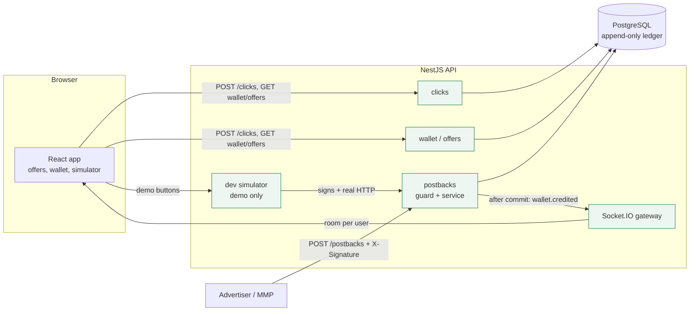
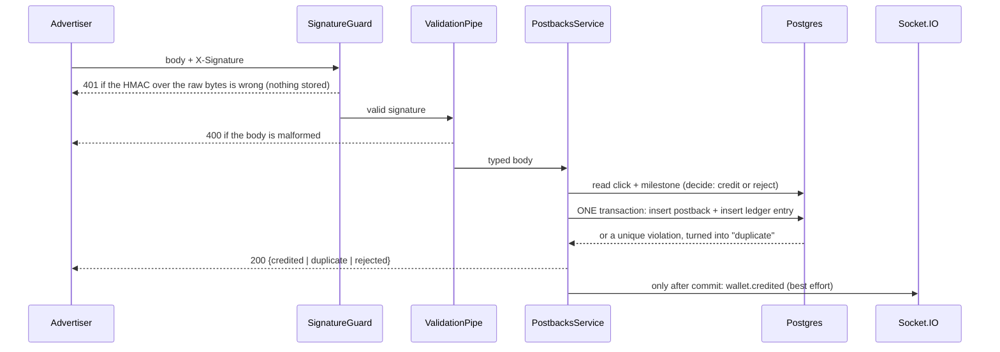

# RewardRail

A small version of how rewards apps like Freecash pay users, built to show how to do the hard
part reliably.

**The problem.** A game studio pays to acquire users. When a user reaches a milestone ("reach
level 10"), the studio's tracking service calls our server with a **postback** (a server-to-server
HTTP request), and we credit the user's wallet. That sounds easy until you remember that postbacks
are retried, can arrive twice at the same instant, out of order, late, or forged by anyone who
finds the URL, and the one thing you must never do is **pay twice**.

## Try it in two minutes

1. Open **Offers**, press **Start offer** on a game.
2. Open the **Advertiser simulator** and press **Send the same postback 20× at once**.
3. Look at the balance: it went up **once**. The log shows `credited` ×1 and `duplicate` ×19.
4. Try **bad signature** (401, nothing stored), **unknown click** (rejected, kept for inspection),
   **inflated payout** (we pay our own amount) and **out of order** (each milestone pays once).
5. Open the **Wallet** in a second window: a toast appears live when a credit lands.

## Architecture



What happens to one postback (`POST /postbacks`):



## Run it locally

Requirements: Node 20+, Docker.

```bash
npm install
cp api/.env.example api/.env && npm run db:up
npm run db:migrate --workspace api    # applies the migrations (answer the prompt if asked)
npm run db:seed --workspace api       # 2 users, 3 offers
npm run dev:api                       # terminal 1: http://localhost:3000/health
npm run dev:web                       # terminal 2: http://localhost:5173
```

Postgres is published on **port 5433** (not 5432) so it doesn't clash with a Postgres you may
already have running. Change it in `docker-compose.yml` and `api/.env` if you prefer.

### Tests

```bash
npm test
```

This rebuilds a separate `rewardrail_test` database from the migrations (it never touches your dev
data), then runs the tests against **real Postgres**, because only a real database can prove that
the UNIQUE constraints stop double payment under concurrency.

> If you created the Docker volume before `docker/init-test-db.sql` existed, recreate it with
> `npm run db:down -- -v && npm run db:up`.

### Configuration (`api/.env`)

| Variable | Purpose |
|---|---|
| `DATABASE_URL`, `TEST_DATABASE_URL` | Main and test databases. They must differ: tests wipe theirs. |
| `POSTBACK_SECRET` | Shared HMAC secret with the advertiser. The app **refuses to start without it**. |
| `WEB_ORIGIN` | Frontend origin, for CORS (HTTP and Socket.IO). |
| `DEMO_MODE` | `true` keeps the `/dev/*` simulator on when `NODE_ENV=production` (public demo only). |
| `PORT` | API port, default 3000. |

## API

| Endpoint | What it does |
|---|---|
| `GET /offers` | Offers with milestones. |
| `GET /users/:id/offers` | Offers plus this user's progress (started? which milestones paid?). |
| `POST /clicks` `{userId, offerId}` | "Start offer". Returns `{clickId}`; the same user and offer always get the same click. |
| `POST /postbacks` | The advertiser endpoint. Signed with `X-Signature: hex(HMAC-SHA256(rawBody, POSTBACK_SECRET))`. |
| `GET /users/:id/wallet` | `{balanceCents, entries}`. The balance is `SUM(amountCents)` of the ledger. |
| `GET /postbacks?clickId=` | Recent postbacks including duplicates and rejections (newest first, max 50). |
| WebSocket `wallet.credited` | `{userId, amountCents, offerTitle, milestoneLabel}`, sent to that user's room after a credit commits. |
| `POST /dev/simulate-postback`, `POST /dev/reset` | Demo only (see Tradeoffs). |

`POST /postbacks` answers **200** for `credited`, `duplicate` **and** `rejected` (the request was
handled; an error code would only make the advertiser retry), **401** for a bad or missing
signature, and **400** for a malformed body from a correctly signed request.

## What can break, and how it's handled

| What goes wrong | How it's handled | Proven by |
|---|---|---|
| **The same postback twice** (retries) | `Postback.eventId` is UNIQUE. We insert first and treat the unique violation as "duplicate"; there is no check-then-insert. | sequential retry test |
| **The same postback 50× at the same instant** | Same mechanism: the database picks one winner. | 50× `Promise.all` test: 1 credit, 49 duplicates |
| **Different `eventId`s for the same milestone** | `LedgerEntry` is UNIQUE on `(userId, milestoneId)`. The loser is stored as `duplicate` / `milestone_already_paid`. | sequential and 50× concurrent tests |
| **Forged postbacks** | HMAC-SHA256 over the **raw bytes**, compared with `timingSafeEqual`. Checked in a guard that runs *before* validation, so unsigned callers learn nothing about our schema. Nothing is stored for them. | 6 guard tests, plus unit tests for the comparison |
| **Replays** | A replay carries a valid signature but an existing `eventId`, so it can't pay twice. We also reject timestamps more than 5 minutes in the **future**. We deliberately do **not** reject old timestamps: late postbacks are real money. | future-timestamp and 1-year-old tests |
| **Out of order** | Each milestone is its own event and pays once, independently. Level 10 before level 5 is fine. | out-of-order test |
| **Unknown click / unknown milestone** | Stored as `rejected` with a reason (kept for "why wasn't I paid?"), never credited, answered with 200. | two rejection tests |
| **Event arrives before the click exists** | A rejected `eventId` is *not* blocked forever: a retry is judged again. The stored row is claimed with `UPDATE … WHERE status = 'rejected'`, so even 20 simultaneous retries credit once. | rejected-retry tests incl. 20× concurrent |
| **Advertiser sends a wrong amount** | We pay `Milestone.payoutCents` from our table, never the payload. A mismatch is logged and the claimed value is kept for audit. | payout mismatch test |
| **Crash mid-credit** | The postback row and the ledger entry are written in **one transaction**: both exist or neither. After a crash the advertiser's retry simply completes the job. | transaction structure; the retry tests |
| **Notification fails or is lost** | The WebSocket event is sent after commit and is fire-and-forget: a failure is logged and never affects the response or the money. The wallet always reads the ledger, so a refresh shows the truth. | throwing-emit test; no-event-before-commit test |
| **Double tap on "Start offer"** | One click per `(userId, offerId)`, enforced by a UNIQUE constraint. | 20× concurrent test |

Two Postgres facts that shaped the code, worth knowing:

- Once a statement fails inside a transaction, the **whole transaction is aborted**. So unique
  violations are caught *outside* the transaction, and the `duplicate` record is written in a
  separate small write.
- Money is **integer cents** everywhere, and the ledger is **append-only**: the balance is
  `SUM(amountCents)`, with no balance column that could drift.

## Tradeoffs and known limits

- **No real authentication for users.** The user switcher sends a `userId` that the server trusts,
  so anyone who knows an id can read that wallet or listen to its toasts. Nobody can *create*
  money this way (credits only come from signed postbacks), but a real system would verify a token
  and derive the user from it. Advertisers *are* authenticated, by the HMAC signature.
- **The simulator holds the secret on the server, not in the browser.** `/dev/simulate-postback`
  signs with `POSTBACK_SECRET` and calls our own public endpoint over HTTP, so the demo exercises
  the real code path. It answers 404 when `NODE_ENV=production`. A public demo opts in with
  `DEMO_MODE=true`, which means anyone can create credits for the demo users: acceptable only
  because the database holds nothing but demo data.
- **Postbacks with a bad signature aren't stored**, so you can't see attempted forgeries in
  `GET /postbacks`. That keeps unauthenticated traffic away from the database; a rate-limited
  security log would be the next step.
- **A re-judged rejection overwrites the row.** Retries of a rejected `eventId` update it in place
  (one row per event), so the history of earlier attempts is lost. An `attempts` counter or an
  attempts table would keep it.
- **The toast can be lost** if the server crashes between commit and emit (the money is safe).
- `GET /postbacks` and the user routes are open, like the rest of the user-facing API.

## What I'd do next with more time

- **Outbox pattern** for notifications: write the event in the same transaction as the credit and
  deliver it from a worker, so a crash can't lose it.
- **Cash-outs as negative ledger entries.** The schema already allows it (`offerId`, `milestoneId`
  and `postbackId` are optional), with the balance check done in the same transaction.
- **Fraud scoring** on click-to-install time, device and IP signals, and a hold period before
  payout.
- **Rate limiting** on `/postbacks` and `/clicks`, and a signature-failure log.
- **Real auth** (sessions or JWT) and per-advertiser secrets with rotation.
- **Observability**: structured logs with the `eventId`, metrics for duplicate and rejection rates,
  and alerts on payout-mismatch spikes.
- **Prerequisite milestones** (level 10 only after level 5) as an explicit, per-offer rule with a
  `pending` state, instead of the current independent milestones.

## Deploying

The API needs Node and Postgres; the web app is static files.

1. **API + Postgres** (Render, Railway or Fly): set `DATABASE_URL`, `POSTBACK_SECRET` (a long random
   value), `WEB_ORIGIN` (the web app's URL), `NODE_ENV=production`, and `DEMO_MODE=true` if you
   want the simulator on a public demo. Build with `npm run build --workspace api`; on release run
   `npx prisma migrate deploy` (and `npm run db:seed --workspace api` once for the demo data);
   start with `npm run start --workspace api`.
2. **Web** (Vercel or Netlify): build `npm run build --workspace web` with `VITE_API_URL` set to
   the API's public URL (no trailing slash). Publish `web/dist`.

## Project layout

```
api/
  prisma/               schema, migrations, seed
  src/postbacks/        signature guard, postback service (the core), list endpoint
  src/clicks/           "Start offer"
  src/wallet/           balance (derived from the ledger) and history
  src/offers/           offers and per-user progress
  src/realtime/         Socket.IO gateway (wallet.credited)
  src/dev/              demo-only simulator and reset
  test/                 e2e tests against real Postgres
web/
  src/pages/            Offer wall, Wallet, Advertiser simulator
  src/useWalletSocket.ts live toasts
docker-compose.yml      Postgres 16 (+ a test database)
CLAUDE.md               spec, phases, decisions
```

## How AI tools were used

This was built with Claude Code as a pair: the spec and the design decisions (for example the
rules for rejected retries, when to emit notifications, and what the replay window should be) were
settled in a written Q&A first, and each piece was reviewed before the next started. Every safety
claim above has a test, and I checked the important tests by **breaking the code on purpose** and
confirming they fail. That caught real problems in AI-written output:

- A test meant to prove "the event is sent only after the commit" **passed even when the emit was
  moved before the commit**, because it was a race between two connections (and Prisma queries are
  lazy and don't start until awaited). It was rewritten to hold a database lock open, so the
  credit is provably still in progress while we assert that nothing has been sent.
- A wallet test assumed an unordered query returned rows in a fixed order; it passed for a while
  and then failed once Postgres returned them differently.
- A first mutation check didn't even compile and so "proved" nothing; it was redone.

Other limits: I have not clicked through every button in a browser session (the API and socket
paths are tested end to end, and the pages were checked with headless screenshots).
